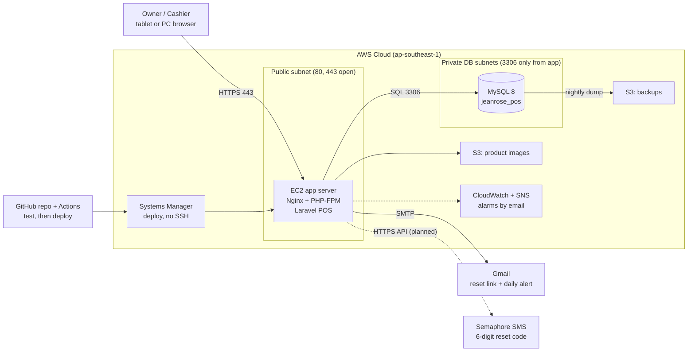
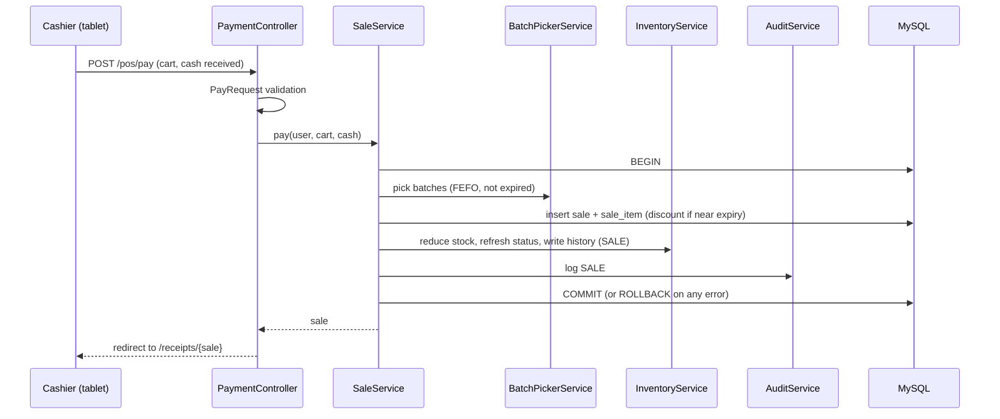

# 08 - Architecture (cloud and application)

Two views: where the system runs (cloud) and how the code is organized (application). Claude Code must follow both.

## A. Cloud architecture (capstone version, AWS Singapore ap-southeast-1)
Picture: `docs/architecture/cloud-architecture.png`



| Part | Decision |
|---|---|
| Server | One small EC2 (Ubuntu), Elastic IP, Nginx + PHP 8.3 FPM, Laravel in `/var/www/jeanrose-pos` |
| Database | MySQL 8.0 in private subnets (RDS, or MySQL on the same server for lower cost). Only the app can connect, using `pos_user` |
| HTTPS | Free Let's Encrypt certificate on Nginx, HTTP redirects to HTTPS |
| Firewall chain | internet -> app (80, 443; SSH only from team IPs) -> database (3306 only from the app) |
| Secrets | Only in the server `.env`, never in GitHub |
| Deploy | GitHub Actions runs tests; deploy by Systems Manager or manual `deploy.sh` |
| Backups | Daily database backup kept 7 days plus nightly dump to S3 |
| Monitoring | CloudWatch alarms (CPU, status) with email alerts |
| Not used (cost) | Load balancer, NAT Gateway, Docker, Multi-AZ. Can be added later |
| Local development | Laragon (PHP 8.3, MySQL 8.4, Composer) on each laptop |

## B. Application architecture (Laravel)
Style: classic server-rendered MVC with a thin controller and a service layer. Blade + Bootstrap 5 CDN, no Vite or npm.

```
request -> routes/web.php -> middleware (auth, can:owner, throttle)
        -> Controller (thin: validate with FormRequest, call a service, return a view or redirect)
        -> Service (business rules, DB::transaction)
        -> Eloquent Models -> MySQL (jeanrose_pos)
        -> Blade view (Bootstrap) -> browser
```

### Folder layout
```
app/
  Http/
    Controllers/    AuthController, PasswordResetController, PosController, PaymentController,
                    ReceiptController, AlertController, SalesRecordController, InventoryController,
                    ProductController, ExportController, ImportController, AuditLogController, HealthController
    Middleware/     (use Gate 'owner' via can:owner; no custom RBAC)
    Requests/       LoginRequest, PayRequest, VoidRequest, ProductRequest, StockRequest, PriceRequest, ImportRequest
  Models/           UserAccount, Category, Supplier, Product, ProductBatch, Inventory, InventoryHistory, Sale, SaleItem, AuditLog,
                    AlertNotification
  Services/         SaleService, InventoryService, StockStatusService, BatchPickerService, AuditService, AlertService, (Sms - planned)
  Exports/          SalesExport, InventoryExport, AuditLogExport
  Imports/          ProductsImport (planned)
  Mail/             DailyStockAlertMail
  Console/Commands/ RefreshStockStatus, SendDailyAlertEmail
config/pos.php      near_expiry_days, near_expiry_discount_percent (from .env)
routes/web.php      guest group, auth group, owner group (can:owner)
routes/console.php  schedule: RefreshStockStatus 06:00, SendDailyAlertEmail 08:00 (Asia/Manila)
resources/views/    layouts/app.blade.php (viewport, Bootstrap CDN, role-based menu), auth/, pos/, receipts/,
                    sales/, inventory/, products/, alerts/, audit/, errors/403.blade.php, partials/
tests/Feature/      LoginTest, RolesTest, PosTest, PayNowTest, VoidTest, StockStatusTest, InventoryTest, AuditLogTest
docs/               these files
```

### Layer rules
1. **Controllers are thin.** No business rules, no raw SQL.
2. **Only services change stock.** Every change to `inventory.quantity_on_hand` goes through `InventoryService` so that
   `stock_status` and `inventory_history` stay consistent.
3. **`SaleService`** has `pay()` and `void()`. Each runs in one `DB::transaction()` and uses `BatchPickerService` (FEFO),
   `StockStatusService` (status) and `AuditService` (audit rows).
4. **`StockStatusService`** is the only place with the status rule (OUT OF STOCK > NEAR EXPIRY > LOW STOCK > OKAY). After each refresh
   it calls `AlertService::sync()`, the only code that writes `alert_notification`.
5. **`AuditService::log(user, action, module, ref, details, saleId = null)`** is the only way to write `audit_log`.
6. **Models** map tables only (see `02-database-schema.md`), with relationships, no business logic.
7. **Owner-only** routes live in one route group with `can:owner`; the Gate is defined once in `AppServiceProvider`.
8. **Validation** in FormRequests. **Views** only show data; no queries in Blade.
9. External services (Gmail, Semaphore) are called from services or Mailables, never from views or controllers directly.

### Pay Now flow


### Naming and style
Controllers `XxxController`, services `XxxService`, tests `XxxTest`. Routes named (`pos.index`, `pos.pay`, `sales.void`, ...).
Short comments in plain English. One feature per branch (`feature/<name>`).
