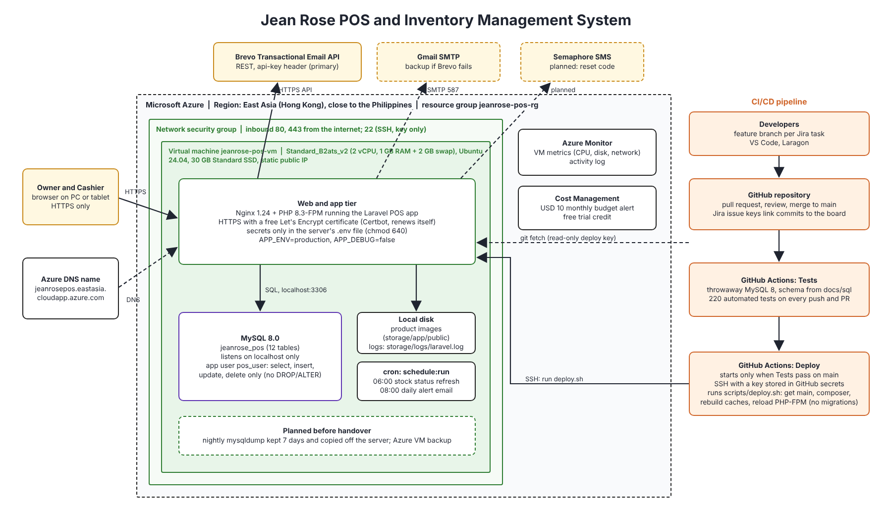
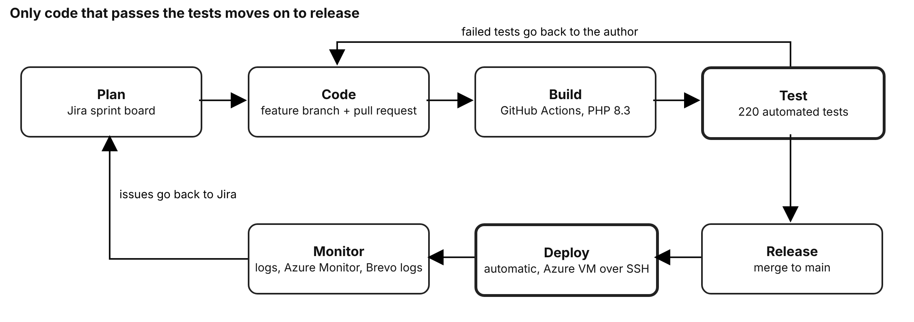

# System Architecture: Jean Rose POS and Inventory Management System

Jean Rose Beauty Products Trading · Prepared by Team 8: Salcedo, Tristan; Contadan, Jeric; Pascual, Megryan; Panis, Jayson; Olvina, Drew

The system is live at **https://jeanrosepos.eastasia.cloudapp.azure.com**, running on one Microsoft Azure virtual machine.

## Documents in this folder

| File | What it is |
| --- | --- |
| `Jean_Rose_POS_SDS.pdf` | System Design Specification |
| `Jean_Rose_POS_Cloud_and_DevOps_Architecture.pdf` | Cloud and DevOps architecture, as deployed |
| `Jean_Rose_POS_MySQL_Database_Schema.pdf` | The 12-table MySQL schema and data dictionary |
| `figure1-cloud-architecture.png` | Cloud architecture diagram |
| `figure2-devops-pipeline.png` | DevOps pipeline diagram |
| `cloud-architecture.png` | Same diagram as figure 1, kept so older links still work |

## 1. Overview

The Jean Rose POS and Inventory Management System is a Laravel (PHP) web application hosted on one Microsoft Azure virtual machine. Nginx and PHP-FPM serve the application, and a MySQL 8 database runs on the same machine and accepts connections from the machine itself only. The owner and the cashier use a browser on a PC or tablet.

The application is the only component that talks to the database, the local file storage and the Brevo email API. GitHub Actions tests every change, and when the tests pass on the `main` branch it deploys the new code to the server automatically.

## 2. Assumptions

- The system is a web application used in a browser on a PC or tablet at the counter; nothing is installed on the devices.
- Microsoft Azure is the cloud provider, using a free trial subscription with USD 200 credit. The server is in the East Asia (Hong Kong) region, close to the Philippines.
- The database is the `jeanrose_pos` schema (12 tables), created from `docs/sql/jeanrose_pos.sql` in this repository.
- The Brevo Transactional Email API sends the password reset links and the daily alert email. Gmail SMTP is the automatic backup.
- The system has two account types, OWNER and CASHIER, and accepts cash payments only.
- The team plans work in Jira and uses GitHub for code, reviews, automated tests and deployment.

## 3. Hosting decision and justification

| Layer | Choice | Justification |
| --- | --- | --- |
| Cloud provider | Microsoft Azure, free trial subscription (USD 200 credit), resource group `jeanrose-pos-rg` | The credit covers the project period; an Ubuntu virtual machine is simple to set up and explain |
| Application server | One virtual machine `jeanrose-pos-vm`, size Standard_B2ats_v2 (2 vCPU, 1 GB RAM plus a 2 GB swap file), Ubuntu 24.04 LTS, 30 GB Standard SSD, region East Asia | A shop with two user roles needs only a small server |
| Web address | Static public IP with the Azure DNS name `jeanrosepos.eastasia.cloudapp.azure.com` | A stable, free address; no paid domain is needed |
| HTTPS | Free Let's Encrypt certificate installed with Certbot, renewed automatically; HTTP redirects to HTTPS | Protects logins and sales data in transit |
| Firewall | Network security group: ports 80 and 443 open to users; port 22 for SSH with key-only login | All other ports stay closed; GitHub Actions deploys over SSH |
| Database | MySQL 8.0 on the same virtual machine, localhost only | Lowest cost; matches the schema script; no database port is exposed |
| File storage | Product images on the server's disk (`storage/app/public`, served through `storage:link`) | Simple and enough for one server |
| Email | Brevo Transactional Email API (primary) with Gmail SMTP as automatic backup | Brevo is a REST API over HTTPS with delivery logs and 300 free emails per day; Gmail keeps emails flowing if Brevo fails |
| Scheduler | One cron entry running Laravel's scheduler every minute | Runs the 06:00 stock status refresh and the 08:00 alert email |

## 4. Server configuration

| Item | Configuration |
| --- | --- |
| Operating system | Ubuntu 24.04 LTS; time zone Asia/Manila; 2 GB swap file for the 1 GB of memory |
| Web server | Nginx 1.24. The site root is `/var/www/jeanrose-pos/public`. Responses include `X-Frame-Options: SAMEORIGIN` and `X-Content-Type-Options: nosniff`; hidden files such as `.env` are denied; requests up to 8 MB are accepted for image uploads. |
| PHP | PHP 8.3 with PHP-FPM and the extensions mysql, mbstring, xml, curl, zip, gd, intl and bcmath; `upload_max_filesize` 4 MB and `post_max_size` 8 MB |
| Application | Laravel app in `/var/www/jeanrose-pos`, a clone of this repository. Packages are installed with `composer install --no-dev --optimize-autoloader`. Configuration, routes and views are cached. |
| Production settings | `APP_ENV=production`, `APP_DEBUG=false` (no error details are shown to users), `APP_URL` set to the site address (every link, including password reset links, is built from it) |
| Secrets | The database password, the Gmail App Password and the Brevo API key are stored only in the server's `.env` file (permission 640). `.env` is never committed to Git. |
| File permissions | `storage` and `bootstrap/cache` are owned by the app user and the `www-data` group with permission 775 |
| Scheduler | Cron runs `php artisan schedule:run` every minute |
| Code access | The server pulls code from GitHub with a read-only deploy key; it cannot push changes |

## 5. Database and storage

| Item | Configuration |
| --- | --- |
| Database | MySQL 8.0, InnoDB, utf8mb4, schema `jeanrose_pos` (12 tables), created once from `docs/sql/jeanrose_pos.sql`. Laravel migrations are not used. |
| Network access | MySQL listens on localhost only; port 3306 is not open in the network security group. |
| Database user | The application connects as `pos_user` with only SELECT, INSERT, UPDATE and DELETE rights on `jeanrose_pos`, so it cannot drop or alter tables. The root account is used only for maintenance on the server. |
| Passwords | User passwords are stored only as bcrypt hashes in `user_account.password_hash`. Password reset tokens are also stored as hashes. |
| Test database | `jeanrose_pos_test`, created from `docs/sql/jeanrose_pos_test.sql`. Automated tests run here (on laptops and in GitHub Actions) and every test rolls back. |
| Images | Uploaded product pictures are saved in `storage/app/public/products`; the database stores only the path in `product.image_path`. Without an upload, a placeholder image is used. |
| Backups | The schema scripts are kept in GitHub. Before handover: a nightly database dump kept for 7 days and copied off the server, plus Azure VM backup. |

## 6. External services and scheduled jobs

| Service | Use |
| --- | --- |
| Brevo Transactional Email API | Sends the daily stock and expiry alert to the owner and the password reset links. `POST https://api.brevo.com/v3/smtp/email` over HTTPS with an `api-key` header; the key is limited to transactional email. A successful call returns `201 Created` with a `messageId`. |
| Gmail SMTP | Backup email channel used automatically when Brevo returns an error or times out. `smtp.gmail.com`, port 587 with TLS, Google App Password. |
| Let's Encrypt | Free HTTPS certificate, renewed automatically by Certbot. |
| GitHub and GitHub Actions | Source code, pull requests, automated tests and automatic deployment. |
| Jira | Sprint board. Branch names, commits and pull requests start with the Jira issue key, so each card shows its code. |
| Azure Monitor and Cost Management | Virtual machine metrics (CPU, disk, network) and a USD 10 monthly budget alert to the project email. |

| Scheduled command | Runs | Purpose |
| --- | --- | --- |
| `php artisan pos:refresh-stock-status` | Daily at 06:00 (Asia/Manila) | Recalculates every stock status and opens or closes alerts, because expiry depends on the date |
| `php artisan pos:send-daily-alerts` | Daily at 08:00 (Asia/Manila) | Emails new alerts to every active owner once; sends nothing when there are none |

## 7. DevOps pipeline

Only code that passes the automated tests reaches the live system.

1. **Plan:** tasks on the Jira sprint board.
2. **Code:** one feature branch per task and a GitHub pull request.
3. **Build:** GitHub Actions installs PHP 8.3 and the Composer packages.
4. **Test:** GitHub Actions starts a temporary MySQL 8 database, loads `docs/sql/jeanrose_pos_test.sql` and runs `php artisan test` (220 tests). Failed tests go back to the author.
5. **Release:** the pull request is merged into `main`.
6. **Deploy:** GitHub Actions connects to the Azure server over SSH and runs `scripts/deploy.sh`.
7. **Monitor:** application log, Azure Monitor and Brevo email logs. Issues go back to Jira.

### 7.1 Continuous integration

The workflow `.github/workflows/tests.yml` runs on every push and every pull request. It builds the test database from the schema script, so a broken schema or a failing test stops the change before it is merged. The pull request shows the result, and only green pull requests are merged.

### 7.2 Continuous deployment

The workflow `.github/workflows/deploy.yml` starts only after the Tests workflow succeeds on `main`; it can also be started by hand from the Actions tab. Only one deployment runs at a time. It uses three GitHub secrets: `DEPLOY_HOST`, `DEPLOY_USER` and `DEPLOY_SSH_KEY`. The key is written to a private temporary file, used for one SSH connection, and deleted.

On the server, `scripts/deploy.sh` does the following:

1. Puts the site in maintenance mode (`php artisan down`).
2. Gets the latest `main` from GitHub (`git fetch` and `git reset --hard origin/main`).
3. Installs packages (`composer install --no-dev --optimize-autoloader`).
4. Rebuilds the configuration, route and view caches and checks the storage link.
5. Fixes the permissions of `storage` and `bootstrap/cache`.
6. Reloads PHP-FPM and brings the site back online (`php artisan up`).

The site always comes back online, even when a step fails, and a failed step marks the GitHub run red. The script never runs migrations or SQL; database changes are applied by hand from the scripts in `docs/sql`. The first automatic deployment finished successfully in 15 seconds.

### 7.3 Manual deployment and rollback

- **Redeploy:** Actions tab, Deploy workflow, Run workflow on `main`.
- **Roll back:** revert the pull request on GitHub; the revert passes the tests and is deployed automatically. In an emergency, check out the previous commit on the server and rebuild the caches.

## 8. Environments and branching

| Environment | Where it runs | Purpose |
| --- | --- | --- |
| Development | Team laptops: Laragon, PHP, local MySQL (`jeanrose_pos` with sample data) | Writing and trying code |
| Test | GitHub Actions (temporary MySQL) and the local `jeanrose_pos_test` database | Automated tests on every push and pull request |
| Production | Azure virtual machine `jeanrose-pos-vm` | Real sales and inventory |

**Git workflow**

1. Each Jira task gets its own branch, named with its Jira issue key and a short description.
2. Commits and the pull request title start with the same Jira key.
3. The Tests check must pass and a teammate reviews the pull request.
4. The pull request is merged into `main`; changes are never pushed directly to `main`.
5. GitHub Actions deploys `main` to production automatically.

## 9. Security

| Area | Measure |
| --- | --- |
| Access control | Two account types in `user_account.role`: OWNER and CASHIER. Inactive accounts cannot log in. Owner pages are protected on the server by one `owner` check, so a cashier who types an owner address gets Access denied (403). |
| Login | Username and password, one generic error message, at most 5 attempts per minute, and a new session ID after login. Every login is written to the audit log. |
| Passwords | Only bcrypt hashes are stored. Reset links are single-use, stored as a hash, expire after 60 minutes, and are limited to 3 requests per email per 15 minutes. |
| Forms | CSRF protection and server-side validation on every form. Prices and totals are always recalculated on the server; values sent by the browser are ignored. |
| Transactions | Pay Now, Void, restock and product changes each run in one database transaction with row locks, so stock is never changed twice or half-saved. Double taps are blocked. |
| Transport | HTTPS only, with HTTP redirected to HTTPS. Links are built from `APP_URL`, so a forged Host header cannot change a reset link. |
| Secrets | Kept only in the server's `.env` file and in GitHub secrets; never in the code. The Brevo key is limited to transactional email. |
| Server access | SSH with keys only, no password logins. The server's GitHub key is read-only. |
| Database | Localhost only; the application user cannot drop or alter tables. |
| Audit trail | `audit_log` records logins, sales, voids, inventory updates, Excel exports and password resets; `inventory_history` records every stock change. The audit log cannot be edited or deleted in the application. |

## 10. Monitoring and backup

| Area | Measure |
| --- | --- |
| Application log | `storage/logs/laravel.log` records errors, email results (including the Brevo `messageId`) and fallbacks to Gmail. |
| Server | Azure Monitor shows CPU, disk and network use of the virtual machine. |
| Email | The Brevo dashboard shows each email as sent, delivered, opened or clicked. |
| Cost | Azure Cost Management shows credit use; a USD 10 monthly budget alert emails the project address. |
| Deployments | Every test run and deployment is listed in the GitHub Actions tab with its result. |
| Backup and recovery | Code and schema scripts are in GitHub, so the application can be rebuilt by redeploying. Before handover: a nightly database dump kept for 7 days and copied off the server, Azure VM backup, and one test restore. |

## 11. Hardware and software

| Item | Specification |
| --- | --- |
| Client devices | Tablet (landscape, 1024 px wide or more) or PC at the counter, with a modern browser (Chrome, Edge or Safari) |
| Printing | Receipts are printed through the browser; no printer or cash drawer is integrated |
| Server | Azure Standard_B2ats_v2: 2 vCPU, 1 GB RAM plus 2 GB swap, 30 GB Standard SSD, Ubuntu 24.04 LTS |
| Database | MySQL 8.0 |
| Back end | Laravel 13 on PHP 8.3, Composer, Nginx 1.24, PHP-FPM |
| Front end | Blade templates, Bootstrap 5 from a CDN, a small amount of plain JavaScript, Google Fonts; no npm build step |
| Other software | Laravel Excel (`maatwebsite/excel`), Brevo API, Gmail SMTP, Certbot, GitHub and GitHub Actions, Jira, Postman, MySQL Workbench |
| Network | A stable internet connection at the shop; during an outage, sales are written on paper and encoded afterward |

## 12. Estimated monthly cost

| Item | Approximate cost |
| --- | --- |
| Virtual machine (Standard_B2ats_v2, East Asia) | USD 9.56 per month |
| Disk (30 GB Standard SSD) and static public IP | about USD 5 per month |
| DNS name and HTTPS certificate | Free |
| Brevo email API (up to 300 emails per day) | Free |
| Gmail SMTP backup | Free |
| **Total** | **about USD 15 per month** |

The cost is covered by the Azure free-trial credit for now. Before handover, the system moves to the owner's own paid Azure subscription.

## 13. Deployment verification

| # | Check | Expected result | Result |
| --- | --- | --- | --- |
| 1 | Open the site | Login page over HTTPS with a valid certificate | Pass |
| 2 | Owner login and POS | Products, stock badges and alert count shown | Pass |
| 3 | Sale and receipt | Sale saved with receipt, cash and change | Pass |
| 4 | Near-expiry discount | 10 percent discount applied automatically | Pass |
| 5 | Void a sale | Sale marked VOIDED, stock returned | Pass |
| 6 | Excel export | File downloads; voided sale not counted | Pass |
| 7 | Cashier login | Only the POS; owner pages blocked | Pass |
| 8 | Audit log | Logins, sales, void, exports and password reset recorded | Pass |
| 9 | Password reset email | Delivered through Brevo with an HTTPS link | Pass |
| 10 | Daily 08:00 alert email | One email listing the open alerts | Pass |
| 11 | Automatic deployment | Deploy run succeeds after a merge; site still works | Pass |

## AI use

We used AI tools as assistants for parts of the code, the tests and the documentation. The team made the final decisions, reviewed every change, ran the tests, and deployed and tested the live system.
