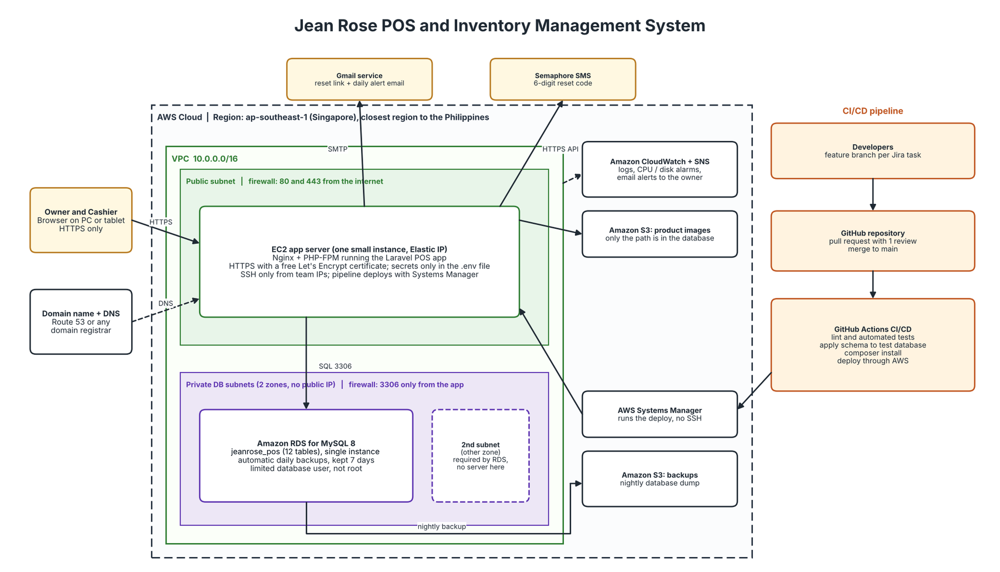
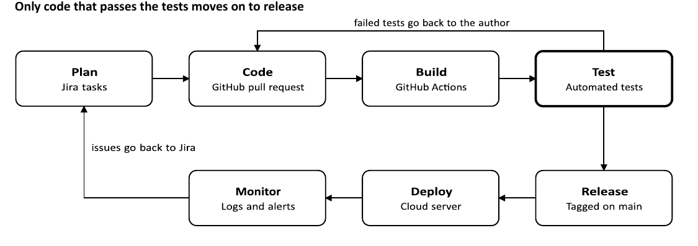

# System Architecture: Jean Rose POS and Inventory Management System

Jean Rose Beauty Products Trading. Source: System Design Specification, Section II (Cloud and DevOps Architecture).

## Architecture Overview

The POS runs as a Laravel (PHP) web app on one cloud server with Nginx and PHP-FPM, with a MySQL 8 database in private subnets and cloud file storage for product images and backups. The owner and cashier use a browser on a PC or tablet. The web app server is the only component that talks to the database, file storage, Gmail and the SMS service. A GitHub Actions pipeline tests every change and deploys it through AWS Systems Manager.

*Figure 1. Updated cloud architecture (lean version for the Philippines, AWS Singapore region).*

## Assumptions

- The POS is a web app used by the owner and cashier in a browser on a PC or tablet.
- AWS is the cloud provider. Azure or Google Cloud would use the same layout.
- The database is the `jeanrose_pos` schema (12 tables) built in MySQL Workbench.
- Gmail is used for password recovery emails, as shown in the Level 0 DFD.
- The team already uses Jira (planning) and GitHub (code).

## Hosting Decision and Justification

| Layer | Choice | Justification |
|---|---|---|
| Cloud provider | AWS | Widely documented, with a free tier for students |
| App server | One virtual server (EC2 or Lightsail), about 2 vCPU and 2 to 4 GB RAM | A shop with two user roles needs a small server |
| Web access | Domain name with a free SSL certificate, HTTPS only | Protects logins and sales data in transit |
| Firewall | Ports 80 and 443 open to users; SSH only from the team's addresses | Keeps all other server ports closed |
| Database | MySQL 8 on AWS RDS (managed), or MySQL on the app server for a low-cost setup | Matches the MySQL Workbench schema; managed option gives automatic backups and patching |
| File storage | AWS S3 | Cheap, durable storage for product images |
| Email | Gmail service | Password recovery and reset; matches the external entity in the DFD |

Hosting verification: the site loads over HTTPS, the server can reach the database, and a password recovery email is sent and received.

## Database and Storage Configuration

| Item | Configuration |
|---|---|
| Database | MySQL 8, InnoDB, utf8mb4, created from the `jeanrose_pos_schema.sql` script |
| Network access | Accepts connections only from the app server, never from the public internet |
| Database user | The app connects with a limited user, not root |
| Passwords | Stored only as `password_hash` in `user_account` |
| Backups | Automatic daily backups kept 7 days, plus the .sql script stored in GitHub |
| Image storage | Product pictures in AWS S3; the database stores only the path in `product.image_path` |
| Size | The 12 tables hold small text and number records, so a few GB is enough |

## DevOps Pipeline

Only code that passes the tests moves on to release. The stages are:

1. Plan: Jira tasks.
2. Code: GitHub pull request.
3. Build: GitHub Actions.
4. Test: automated tests. Failed tests go back to the author.
5. Release: tagged on main.
6. Deploy: cloud server.
7. Monitor: logs and alerts. Issues go back to Jira.

Every push is built and tested automatically. The test stage also applies the `jeanrose_pos_schema.sql` script to a throwaway MySQL database, so a broken schema fails the pipeline before release.

*Figure 2. DevOps pipeline.*

## Environments and Branching

| Environment | Where it runs | Purpose |
|---|---|---|
| Development | Team laptops, local MySQL | Writing and trying code |
| Test | Cloud server with a separate test database | Automated and manual testing before release |
| Production | Cloud server with the live database | Real sales and inventory |

### Git workflow

1. Each task from Jira gets its own feature branch.
2. A pull request is opened, and at least one teammate reviews it.
3. A merge to main triggers the pipeline and deploys to test.
4. A tagged release is deployed to production.

## Security, Monitoring and Backup

| Area | Measure |
|---|---|
| Access control | Two roles in `user_account.role`: OWNER and CASHIER. Inactive accounts are blocked through `is_active`. Role checks are enforced on the server, not only hidden in the interface. |
| Passwords | Only hashes are stored. Password recovery goes through the Gmail service. |
| Transport | HTTPS only; HTTP redirects to HTTPS. |
| Secrets | Database passwords and keys are kept in the pipeline's secret store, never in the code. |
| Audit trail | The `audit_log` and `inventory_history` tables record who did what and when. |
| Monitoring | Server logs, with alerts for high CPU, low disk space and application errors. |
| Backups | Daily database backups kept 7 days. Restoring is tested once before go-live. |
| Recovery | Redeploy the app from GitHub and restore the latest database backup. |

## Hardware and Software Specifications

| Item | Specification |
|---|---|
| Client devices | Tablet (landscape) or PC at the counter; any modern browser (Chrome, Edge, Safari); nothing to install |
| Optional peripherals | Browser printing for receipts; no printer or cash drawer is supplied or integrated (hardware is out of scope) |
| Server | About 2 vCPU, 2 to 4 GB RAM, 30 GB SSD, Ubuntu LTS |
| Database | MySQL 8, a few GB of storage |
| Software stack | Laravel 13 (PHP 8.3), Composer, Nginx, PHP-FPM, MySQL 8, Laravel Excel, GitHub, GitHub Actions, Jira, AWS S3 |
| Network | Stable broadband at the shop; internet is required, with a paper fallback during outages |

## Estimated Monthly Cost

Assumption only. Verify current pricing before relying on these numbers.

| Item | Approx. cost |
|---|---|
| Virtual server | USD 10 to 15 |
| Managed MySQL (optional) | USD 15 to 20 |
| Storage and backups | USD 1 to 3 |
| Domain | about USD 1 |
| **Total** | **about USD 15 to 40 per month** (lower if MySQL runs on the app server) |
